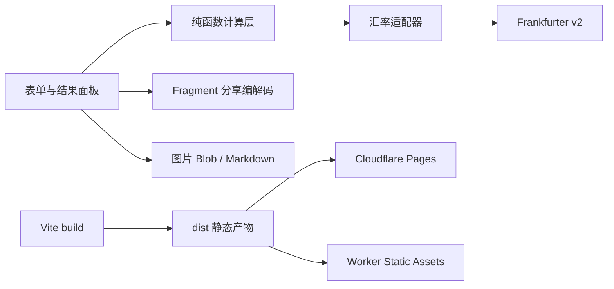

# VPS 转售剩余价值计算器 - Plan

## Goal Capsule

- **Objective:** 让 VPS 转售者能为单台 VPS 快速生成可解释、可分享的报价，明确展示理论剩余价值、折损后建议价、Push 手续费及包含手续费的买家总支付和卖家到手价。
- **Means:** 采用输入与结果同屏的报价计算器布局，兼容 Cloudflare Pages 或 Cloudflare Worker 的纯前端部署。
- **Product authority:** 本计划只覆盖单台 VPS 的即时报价工具；历史报价、套餐库、库存和客户管理不属于当前范围。
- **Open blockers:** 无产品阻塞项；实现阶段需要验证 Frankfurter 的实时 CORS、限流和响应稳定性，汇率服务失败时产品必须阻止计算。
- **Execution profile:** 先完成纯函数计算与失败状态，再接入表单、分享和导出，最后验证 Pages/Worker 部署；部署脚本必须能从干净环境构建并发布静态产物。
- **Tail ownership:** 实现、浏览器验证和部署文档由本计划的实现单元负责；不扩展到后端账户、交易或批量管理。

## Product Contract

### Summary

这是一个面向 VPS 转售者的纯前端报价工具，参考 MeowVPS 的剩余价值计算流程，加入可按续费币种输入的 Push 手续费、可调转售折损率和自包含分享链接。

### Problem Frame

转售者需要把不同币种、付款周期和到期日期换算成买家容易理解的人民币报价。现有手工计算容易遗漏剩余天数、折损和过户手续费，导致报价争议或卖家到手金额不清晰。

### Key Decisions

- **单台即时报价优先**（session-settled: user-directed — chosen over multi-instance workspace: 首版需要快速上线并保持计算器边界）Governs R1, R8。
- **线性价值加手动折损**（session-settled: user-directed — chosen over fixed built-in discount: 不同商家和套餐需要不同转售折价）Governs R3, R4。
- **售价按基础价叠加未由卖家承担的手续费**（session-settled: user-directed — chosen over售价直接作为含费总价: Push 手续费按卖家承担比例计入双方总金额）Governs R5, R6。
- **自包含分享链接**（session-settled: user-directed — chosen over server-stored short links: 无需数据存储且适合纯前端部署）Governs R8。
- **输入与结果同屏**（session-settled: user-directed — chosen over left-right form-only or step flow: 熟练转售者需要边编辑边观察报价）Governs R2, R7。

### Actors

- A1. VPS 转售者：输入套餐和交易信息，调整折损与手续费，生成对外报价。
- A2. 汇率服务：提供必需的自动参考汇率及其更新时间。
- A3. 报价接收者：通过分享链接、图片或 Markdown 查看报价内容；不需要登录或修改原始报价。

### Requirements

**输入与计算**

- R1. 工具必须支持单台 VPS 的一次性报价，不要求登录或服务端账户。
- R2. 输入区必须覆盖续费金额、续费币种、付款周期、交易日期、到期日期、自动汇率状态、售价、转售折损率、Push 手续费及手续费承担方式；VPS 商家、产品名、特色及 CPU、内存、存储、带宽、流量、机房位置等配置字段为可选。
- R3. 理论剩余价值必须按人民币续费成本与剩余时间的线性比例计算；剩余天数取交易日期到到期日期的日历差，过期或无剩余周期时价值为 ¥0。
- R4. 用户填写的折损率必须生成折损后建议价，且结果同时显示理论剩余价值、折损率和折损后建议价。
- R5. Push 手续费必须使用独立金额和币种输入，并按自动汇率换算为人民币；承担方式必须支持买家承担、卖家承担和按比例承担，按比例模式填写 0%–100% 的卖家承担比例，其中买家承担映射为 0% 卖家承担、卖家承担映射为 100% 卖家承担。

**报价呈现**

- R6. 用户填写不含 Push 手续费的基础售价后，工具必须分别显示基础售价、Push 手续费、卖家承担比例、买家总支付和卖家到手价；双方金额始终相等，均为基础售价加上 Push 手续费乘以（1 - 卖家承担比例），卖家承担比例影响计入总价的手续费金额。
- R7. 结果区必须持续可见并随输入更新或重新计算，至少突出显示折损后建议价、售价分析、剩余天数和汇率更新时间；输入与结果采用同屏布局 C。
- R8. 工具必须生成可复现当前报价的自包含分享链接，表单数据编码在 URL 中，不写入服务端；打开链接后应恢复输入并重新获取自动汇率，不能绕过汇率失败规则。

**输出与部署**

- R9. 结果必须支持下载图片和复制 Markdown，两种输出都包含配置、价值明细、Push 手续费明细和分享所需的报价信息。
- R10. 页面必须可作为静态前端部署到 Cloudflare Pages，也可作为 Worker 静态资源部署，不依赖自建后端、数据库或登录服务。

### Key Flows

- F1. 即时报价
  - **Trigger:** 转售者打开工具并填写单台 VPS 信息。
  - **Actors:** A1、A2。
  - **Steps:** 获取自动汇率；填写续费与日期；可选填写折损、售价、Push 手续费和卖家承担比例；计算理论价值、建议价及双方金额；展示结果。
  - **Outcome:** 转售者得到一份可解释的报价摘要。
  - **Covered by:** R1-R7。
- F2. 自动汇率失败
  - **Trigger:** 汇率服务不可用、返回无效数据或无法完成必需换算。
  - **Actors:** A1、A2。
  - **Steps:** 标示汇率获取失败；禁用或阻止计算；保留已填写表单，提示稍后重试。
  - **Outcome:** 不产生使用过期或未知汇率的误导性报价。
  - **Covered by:** R2, R5, R7。
- F3. 分享与导出
  - **Trigger:** 转售者完成计算并选择分享、下载图片或复制 Markdown。
  - **Actors:** A1、A3。
  - **Steps:** 生成自包含 URL 或导出内容；接收者打开链接后恢复输入并遵循汇率规则；导出结果保留手续费拆分。
  - **Outcome:** 报价可在论坛、群聊或私聊中复用和核对。
  - **Covered by:** R8-R10。

### Acceptance Examples

- AE1. **正常外币年付报价**
  - **Given:** 续费金额、币种、年付周期、交易日期和未来到期日期有效，自动汇率已获取。
  - **When:** 用户填写 10% 折损率、售价和 Push 手续费后计算。
  - **Then:** 结果同时显示理论剩余价值、折损后建议价、基础售价、手续费、卖家承担比例、买家总支付和卖家到手价，且双方总金额均为基础售价加上未由卖家承担的手续费。
  - **Covers:** R3-R7。
- AE2. **已过期 VPS**
  - **Given:** 到期日早于或等于交易日。
  - **When:** 用户计算报价。
  - **Then:** 剩余价值和折损后建议价为 ¥0，并明确标示无剩余周期；不显示负数价值。
  - **Covers:** R3, R4。
- AE3. **汇率服务失败**
  - **Given:** 自动汇率请求失败或返回不可用汇率。
  - **When:** 用户尝试计算。
  - **Then:** 计算被阻止，页面显示失败状态和重试路径，已填数据不丢失。
  - **Covers:** R2, R5, F2。
- AE4. **分享链接复现**
  - **Given:** 用户已生成包含可选配置和手续费的报价。
  - **When:** 在新窗口打开自包含分享链接。
  - **Then:** 表单恢复，重新获取汇率，计算成功后展示相同输入下的报价明细；若汇率失败则按 AE3 处理。
  - **Covers:** R8。
- AE5. **导出内容完整**
  - **Given:** 报价包含折损率、基础售价、Push 手续费和卖家承担比例。
  - **When:** 下载图片或复制 Markdown。
  - **Then:** 输出包含理论价值、建议价、基础售价、手续费、卖家承担比例、买家总支付和卖家到手价，并体现手续费明细及双方总金额相等。
  - **Covers:** R6, R9。
- AE6. **卖家承担比例影响总价**
  - **Given:** 基础售价为 ¥100，Push 手续费换算后为 ¥10。
  - **When:** 分别选择卖家承担 0%、50% 和 100%。
  - **Then:** 双方金额分别为 ¥110、¥105 和 ¥100，且每种情况下买家总支付与卖家到手价相等。
  - **Covers:** R5, R6。

### Success Criteria

- 转售者无需服务端账户即可完成单台报价，并能在一次操作中核对双方金额。
- 任何对外分享的报价都能追溯到输入的续费、日期、折损和手续费字段，而不是只显示一个无法解释的总价。
- Cloudflare Pages 和 Worker 静态资源部署均不需要新增后端存储或登录配置。

### Scope Boundaries

**Deferred for later**

- 多台 VPS 批量录入、汇总和批量导出。
- 历史报价、常用套餐模板、库存跟踪和客户管理。
- 服务端短链接、报价撤回、报价有效期和访问统计。

**Outside this product's identity**

- 自动抓取 VPS 商家价格、套餐库存或账户余额。
- 交易撮合、支付、账户托管或实际 Push 操作。

### Dependencies / Assumptions

- 自动汇率服务在浏览器环境可访问并允许跨域请求；具体服务和失败重试策略由规划阶段确定。
- 分享链接中的 VPS 配置、日期和价格属于用户主动编码的信息，拿到链接的人可能读取这些内容；首版不提供加密或权限控制。
- 金额显示以人民币作为统一比较单位，同时保留原始续费和手续费币种。
- 参考行为来源：MeowVPS《VPS 剩余价值计算器》，https://meowvps.com/tools/value-calc/ 。

### Outstanding Questions

**Deferred to Planning**

- 确定分享 URL 的编码压缩、长度控制、字段版本兼容和敏感信息提示文案。
- 确定图片导出的版式尺寸、字体加载和离线导出降级方式。

## Planning Contract

### Key Technical Decisions

- KTD1. **采用 Vite + TypeScript 的静态 SPA**：仓库为空且没有现有框架约束，Vite 能同时产出 Pages 与 Worker Static Assets 所需的静态目录。
- KTD2. **以 Frankfurter v2 作为默认汇率源**：无需 API key，支持按源币种查询 CNY，响应包含更新时间；仅在有效缓存 TTL 内复用成功响应，过期或请求失败时阻止计算（R5, R8）。
- KTD3. **计算层与浏览器副作用分离**：金额、日期和 URL 编解码使用无 DOM 的模块，便于单元测试；网络、剪贴板、下载和 Canvas 适配器留在浏览器层（R3-R9）。
- KTD4. **分享数据写入 URL fragment 的 Base64URL**：避免把 VPS 价格和配置放入常规查询串；载荷带版本、白名单字段和长度校验，超过安全长度时提示用户使用图片或 Markdown（R8）。
- KTD5. **Pages 与 Worker 共用 `dist/` 产物**：Pages 通过 Wrangler Direct Upload 发布；Worker 通过 `wrangler.jsonc` 的 `assets.directory` 托管，同一构建结果避免分叉（R10）。
- KTD6. **部署入口采用可审计脚本 + npm 别名**：`scripts/deploy-pages.sh` 执行构建、检查项目配置并调用 Wrangler；`npm run deploy:pages` 作为一键入口，脚本不保存令牌（R10）。

### High-Level Technical Design

计算流程分为四个阶段：读取并校验输入；取得仍在 TTL 内的汇率；计算人民币续费成本、剩余价值、折损后建议价和含未承担手续费的总价；渲染结果并生成分享/导出内容。任何必需汇率缺失、过期或无效时，流程停在第二阶段并保留输入。

金额内部使用十进制安全的整数最小单位或受控精度数值，最终展示统一保留两位小数；日期按本地日历日期解析，避免时区导致剩余天数偏移。

### Implementation Constraints

- 不在 URL、源码或仓库文件中写入汇率 API key、Cloudflare API token 或其他凭据。
- 汇率请求必须使用 `AbortController` 超时、检查 HTTP 状态和响应字段，并避免每次键盘输入触发网络请求。
- 图片导出优先使用 `canvas.toBlob()` 和对象 URL；外部图片必须同源或带 CORS，导出失败要提供 Markdown 作为替代。
- 分享载荷只允许产品定义的字段，拒绝未知版本、未知字段、非法数字、非法日期和超长 fragment。
- 移动端将双栏折叠为输入在前、结果在后；桌面端保持 C 布局的结果可见性。

### System-Wide Impact

- **浏览器网络：** 每个源币种最多维持一个带 TTL 的汇率缓存条目；缓存失效时重新请求，失败会阻止所有依赖该币种的报价。
- **隐私：** 分享 URL fragment 不发送到服务器日志，但复制、截图和第三方聊天工具仍可能保存其中的报价数据；页面需显示简短提示。
- **部署：** Pages 根路径必须提供 `index.html`；Worker 配置使用 SPA fallback，并让静态资源优先于未匹配路由。

### Risks & Dependencies

- Frankfurter 公共 API 可能限流、调整响应格式或改变 CORS；用响应 schema 校验、超时和明确错误状态降低误报价风险，并将服务地址集中在配置模块。
- Pages Direct Upload 需要 Wrangler 登录和目标项目；脚本应在缺少认证或项目名时给出可执行提示，而不是打印秘密。
- Worker 免费额度和静态资产大小限制会影响高流量场景；首版不执行 Worker 业务代码，降低请求计费和运行时风险。
- URL 长度受浏览器、代理和 Worker 限制；分享载荷应短字段、压缩 JSON，并在接近限制时提前拒绝。

### Sources & Research

- Cloudflare Workers Static Assets 文档：`https://developers.cloudflare.com/workers/static-assets/index.md`。静态资源通过 `assets.directory` 部署，SPA 使用 `not_found_handling: single-page-application`。
- Cloudflare Pages Direct Upload 文档：`https://developers.cloudflare.com/pages/get-started/direct-upload/index.md`。静态站点可通过 Wrangler 发布，根目录需要 `index.html`。
- Frankfurter API 文档：`https://www.frankfurter.app/docs/`。公开汇率接口支持 `base`/`quotes`，允许缓存但会限流。
- MDN URLSearchParams 与 Base64：`https://developer.mozilla.org/en-US/docs/Web/API/URLSearchParams`、`https://developer.mozilla.org/en-US/docs/Web/API/Window/btoa`。分享载荷需使用 UTF-8 和 Base64URL，避免 `+` 被表单编码解释为空格。
- html2canvas 文档：`https://html2canvas.hertzen.com/documentation.html`。它按 DOM/CSS 重建图像，跨源资源需要 CORS。

## Implementation Units

### U1. 建立静态应用与部署基线

- **Goal:** 创建可在本地构建、在 Pages 和 Worker Static Assets 上托管的 Vite + TypeScript 应用。
- **Requirements:** R1, R10。
- **Files:** `package.json`, `tsconfig.json`, `vite.config.ts`, `index.html`, `src/main.ts`, `src/styles.css`, `wrangler.jsonc`, `scripts/deploy-pages.sh`, `README.md`。
- **Approach:** 保持 `dist/` 为唯一构建输出；Worker 配置指向 `dist` 并启用 SPA fallback；Pages 脚本检查 `dist/index.html`、项目名和 Wrangler 可用性后执行构建与 Direct Upload。脚本支持 `CLOUDFLARE_PAGES_PROJECT`、`CLOUDFLARE_ACCOUNT_ID` 环境变量，并允许命令行参数覆盖项目名。
- **Test Scenarios:** 在无构建产物时脚本先构建；缺少项目名时脚本以可读错误退出；构建产物包含 `index.html`；Worker 配置声明静态资源目录和 SPA fallback。
- **Verification:** `npm run build`; `npm run deploy:pages -- --help`; 使用 Wrangler dry-run 或配置检查验证 Pages 参数；本地静态服务器访问根路径和带 fragment 的路径。

### U2. 实现价值与手续费计算核心

- **Goal:** 提供无 DOM、可独立测试的输入校验和报价计算模块。
- **Requirements:** R3-R6。
- **Files:** `src/domain/currency.ts`, `src/domain/calculator.ts`, `src/domain/validation.ts`, `src/domain/types.ts`, `tests/domain/calculator.test.ts`, `tests/domain/validation.test.ts`。
- **Approach:** 计算人民币续费成本和剩余天数；过期归零；按折损率生成建议价；将 Push 手续费换算为人民币；按卖家承担比例计算 `总价 = 基础售价 + 手续费 * (1 - 卖家承担比例)`；买家总支付和卖家到手价都返回总价。统一处理非负金额、0%–100% 比例、无效日期和有限小数。
- **Test Scenarios:** 外币年付正常值；到期日等于交易日；到期日早于交易日；卖家承担 0%、50%、100%；缺失或负数输入；小数舍入和极小手续费；续费币种与手续费币种不同。
- **Verification:** `npm test -- --run tests/domain`; 覆盖 AE1、AE2、AE6，并断言双方总价始终相等。

### U3. 接入汇率状态与主界面

- **Goal:** 实现 C 布局表单、汇率加载状态、输入校验和结果面板。
- **Requirements:** R2, R5, R7。
- **Files:** `src/services/exchange-rate.ts`, `src/ui/form.ts`, `src/ui/result.ts`, `src/main.ts`, `src/styles.css`, `tests/services/exchange-rate.test.ts`, `tests/ui/calculator-flow.test.ts`。
- **Approach:** 汇率适配器按源币种请求 CNY，使用内存 TTL、请求去重和 AbortController；UI 在汇率加载中禁用计算，失败时保留输入并显示重试按钮；计算成功后持续展示剩余天数、理论价值、建议价、基础售价、Push 手续费、卖家承担比例和双方总价。
- **Test Scenarios:** 初次加载；缓存命中不重复请求；HTTP 错误、超时和错误 schema；失败后重试成功；键盘修改输入不触发每字符请求；移动端布局不产生横向滚动；过期状态显示 ¥0。
- **Verification:** `npm test -- --run tests/services tests/ui`; 浏览器手工检查桌面和 320px 视口；使用 Mock Service Worker 或等价 fetch mock 覆盖成功与失败响应。

### U4. 实现分享、图片和 Markdown 导出

- **Goal:** 让转售者安全复现和发送完整报价。
- **Requirements:** R8, R9。
- **Files:** `src/services/share-codec.ts`, `src/services/export.ts`, `src/ui/share-actions.ts`, `src/main.ts`, `tests/services/share-codec.test.ts`, `tests/services/export.test.ts`。
- **Approach:** 将白名单表单字段编码为带版本的 UTF-8 Base64URL fragment；打开页面时先解析并校验，再恢复表单并重新获取汇率；图片导出使用 Blob 和对象 URL，Markdown 提供复制和下载两条路径；超长或非法载荷显示可恢复错误。
- **Test Scenarios:** 含中文配置的编码/解码；未知版本和未知字段；损坏 Base64；超长 fragment；分享打开后恢复输入但仍受汇率失败规则约束；图片导出成功、跨源图片失败降级；Markdown 包含手续费明细和双方相等总价；剪贴板不可用时提供下载或手动复制文本。
- **Verification:** `npm test -- --run tests/services/share-codec.test.ts tests/services/export.test.ts`; 浏览器验证新窗口打开分享链接、复制 Markdown 和下载 Blob。

### U5. 完成部署文档与端到端验收

- **Goal:** 证明清洁环境可构建，并提供 Pages 一键部署与 Worker 部署路径。
- **Requirements:** R10, Success Criteria。
- **Files:** `README.md`, `scripts/deploy-pages.sh`, `wrangler.jsonc`, `tests/smoke/deployment.smoke.test.ts`。
- **Approach:** README 说明 Node/npm、Wrangler 登录、Pages 项目名、环境变量和命令；脚本使用 `set -euo pipefail`、参数校验和不泄露 token 的错误输出；冒烟测试检查构建产物、根路径、SPA fallback 和分享 fragment。
- **Test Scenarios:** 全新 checkout 执行安装和构建；已认证 Pages 项目执行 `npm run deploy:pages -- --project <name>`；未认证、无项目名和无 `dist/index.html` 时快速失败；Worker 本地预览访问根路径及任意 SPA 路径。
- **Verification:** `npm ci`; `npm run build`; `npm test`; `npm run preview`; `npx wrangler pages deploy dist --dry-run`（若当前 Wrangler 支持）；实际部署由维护者在目标 Cloudflare 账户中执行。

## Verification Contract

| 检查 | 命令或证据 | 覆盖 |
|---|---|---|
| 类型与构建 | `npm run build` | U1-U3 |
| 单元与流程测试 | `npm test` | U2-U4 |
| 静态产物 | 检查 `dist/index.html` 与资源引用 | U1, U5 |
| 浏览器冒烟 | `npm run preview` 后验证计算、失败重试、分享、导出 | U3-U5 |
| Pages 部署 | `npm run deploy:pages -- --project <name>` | U1, U5 |
| Worker 部署配置 | Wrangler 配置检查与本地预览 | U1, U5 |

质量门槛：任何必需汇率失败不得生成报价；AE1、AE2、AE3、AE4、AE5、AE6 全部通过；买家总支付和卖家到手价在所有承担比例下相等；分享载荷不包含凭据。

## Definition of Done

- U1-U5 的文件、测试场景和验证项全部完成，废弃的实验文件不留在构建产物或提交中。
- `npm ci && npm run build && npm test` 在干净环境通过。
- 页面在桌面和 320px 移动视口可用，无横向溢出，汇率加载、失败、重试和过期状态可见且不覆盖输入。
- 通过分享链接恢复的报价必须重新获取汇率，并在汇率失败时阻止计算。
- Pages 一键部署脚本在缺少参数或认证时给出可操作错误，在配置完整时发布 `dist/`。
- README 同时记录 Pages Direct Upload 和 Worker Static Assets 两种部署路径，以及不提交令牌的安全要求。
