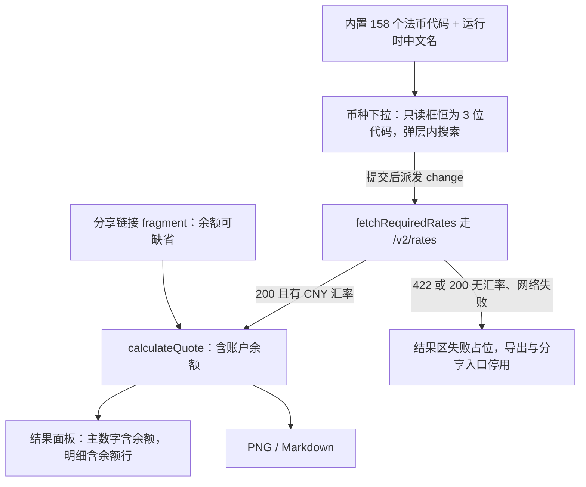
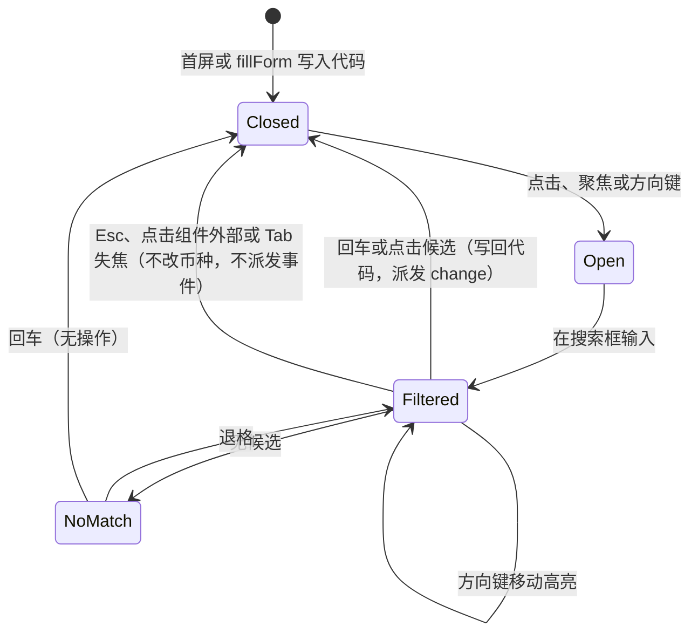

# 币种下拉搜索与账户余额 - Plan

## Goal Capsule

- **Objective:** 转售者不用记币种代码就能选到汇率服务真正支持的币种，报价里也能体现随账号一起转给买家的账户余额，买家与卖家的金额在人机两侧一次看清。
- **Means:** 用一个手写可搜索下拉替换两个币种文本框（KTD1、KTD3），币种清单与汇率同源于 Frankfurter v2（KTD2、KTD4），并在成交报价新增按原币填写的账户余额项（KTD5）。
- **Product authority:** 本计划只覆盖续费币种与手续费币种的输入方式、汇率来源版本、以及成交报价新增的账户余额项；剩余价值、折损率、Push 手续费承担方式的算法与分享链接结构不在改动范围内。
- **Open blockers:** 无。
- **Execution profile:** 先落币种清单与汇率 v2 切换，再做下拉组件并接入两个字段，然后按「口径与表单 → 导出面 → 分享与复位」推进余额，最后统一验证。
- **Tail ownership:** 实现、浏览器验证与部署基线由本计划的实现单元负责，不扩展到后端账户、余额自动抓取或多币种余额拆分。

## Product Contract

### Summary

把「续费币种」和「手续费币种」从手打 3 位字母代码的文本框换成同一个可搜索下拉，候选项覆盖 Frankfurter v2 支持的法币并显示中文名；同时在成交报价里新增按原币填写的账户余额，换算成人民币计入买家总支付与卖家到手价，但不算进售价溢价。汇率来源随之从 v1 切到 v2，币种覆盖因此包含 TWD 等非 ECB 币种。

### Problem Frame

币种现在是两个只能手打 3 位字母的文本框。用户得凭记忆输代码，输错或输成汇率服务不支持的币种时，报价会卡在「汇率获取失败」，而页面上看不出有哪些币种可选。可选项本身也不直观：当前调用的 Frankfurter v1 只有 30 个 ECB 币种，TWD、RUB、VND 这类 VPS 场景里常见的币种根本取不到汇率，用户只能靠试错发现。

成交报价这一块也少一笔钱：VPS 账号里剩余的余额会随账号一起转给买家，它的面值属于买家总支付的一部分，现在只能靠卖家在溢价里手动凑，报价单上看不出这一项，双方对账时容易有争议。

### Key Decisions

- **币种候选只列汇率服务确实支持的法币并显示中文名**（session-settled: user-directed — chosen over 完整 ISO 4217 列表: 能选到却取不到汇率的币种会把用户直接送进失败路径）Governs R2, R3。
- **币种覆盖以 Frankfurter v2 为准，含 TWD 等非 ECB 币种**（session-settled: user-directed — chosen over 沿用 v1 的 30 个 ECB 币种: TWD 是中国用户常遇到的币种）Governs R1。
- **两个币种字段共用同一个可搜索下拉**（session-settled: user-directed — chosen over 只改续费币种: 同一张表单里两个选币入口的体验不该不一致）Governs R2。
- **账户余额按账号原币填写并跟随续费币种，不单独选币种**（session-settled: user-directed — chosen over 余额自带币种下拉、chosen over 按人民币填写: 余额就是账号在商家侧的余额，与续费同币种）Governs R4, R5。
- **账户余额计入买家总支付与卖家到手价，但不计入售价溢价**（session-settled: user-directed — chosen over 计入溢价: 余额是等值现金转移，不是这台 VPS 的加价）Governs R6, R7。

### Requirements

**币种输入**

- R1. 工具必须支持以 Frankfurter v2 覆盖的币种（含 TWD 等非 ECB 币种）作为续费币种与手续费币种，并沿用现有的人民币换算与汇率失败阻断规则。
- R2. 续费币种与手续费币种必须各由一个可搜索下拉提供：点击或键盘展开候选、在弹层内输入即筛选、方向键移动高亮、回车选中、Esc 或点击组件外部取消；两个下拉各自独立开合。
- R3. 下拉候选项必须是一份可花费法币的名单——覆盖汇率服务 v2 支持的法币，排除贵金属与记账单位——展示中文名（缺失时退回代码），无匹配时给出明确提示。
- R9. 货币输入框在任何时刻都必须显示已提交的 3 位大写代码；弹层内的筛选文本不得参与报价计算。

**账户余额**

- R4. 成交报价区必须新增账户余额输入，按原币金额填写，不单独选择币种。
- R5. 账户余额必须随续费币种换算成人民币。
- R6. 账户余额必须计入买家总支付与卖家到手价，两者始终相等。
- R7. 售价溢价必须按不含账户余额的口径计算与展示。
- R8. 结果区、图片导出与 Markdown 导出都必须各含一行账户余额明细，显示折算后的人民币金额与原币金额及其币种。

**兼容与失败**

- R10. 账户余额必须是可选字段：不含该字段的旧分享链接必须继续可解码，缺失时按 0 处理，任何展示位置都不得出现 `NaN`。
- R11. 汇率请求必须区分「币种不受支持或没有可用汇率」与网络/超时失败，且任一类失败都不得继续展示上一份有效报价的明细与导出入口。

### Key Flows

- F1. 选择币种
  - **Trigger:** 用户点击或聚焦续费币种、手续费币种的输入框。
  - **Steps:** 展开候选并聚焦弹层内的搜索框；输入筛选文本；方向键移动高亮；回车选中候选，或按 Esc、点击组件外部、Tab 移开焦点取消；选中后输入框显示 3 位大写代码，触发汇率刷新与重算。
  - **Outcome:** 输入框里始终是一个汇率服务支持的币种代码，取消不改变此前的币种。
  - **Covered by:** R1, R2, R3, R9。
- F2. 填写账户余额
  - **Trigger:** 用户在成交报价里填写余额。
  - **Steps:** 按当前续费币种填写原币金额；换算为人民币；计入买家总支付与卖家到手价；结果区、图片与 Markdown 各增加一行明细。
  - **Outcome:** 双方金额含余额且相等，售价溢价与折损后建议价不含余额。
  - **Covered by:** R4-R8。

### Acceptance Examples

- AE1. **选择非 ECB 币种**
  - **Given:** 用户要报一台按 TWD 续费的 VPS。
  - **When:** 在下拉里输入 `tw` 并选中 TWD。
  - **Then:** 汇率从 v2 取得，报价按 TWD 换算，双方金额相等。
  - **Covers:** R1, R2。
- AE2. **取消不改变已选币种**
  - **Given:** 续费币种当前是 USD，用户展开下拉并输入 `eur` 但未选中。
  - **When:** 按 Esc、点击组件外部或 Tab 移开焦点。
  - **Then:** 续费币种仍为 USD，报价不变，不触发新的汇率请求。
  - **Covers:** R2, R9。
- AE3. **余额计入双方金额**
  - **Given:** 账户余额为 10 USD，卖家承担 0%，续费币种为 USD。
  - **When:** 计算报价。
  - **Then:** 买家总支付与卖家到手价都等于「剩余价值 + 溢价 + 10 美元折人民币 + 计入总价的手续费」，售价溢价与折损后建议价不含那 10 美元折算值。
  - **Covers:** R5, R6, R7。
- AE4. **旧分享链接**
  - **Given:** 一条在本次改动之前生成、载荷里没有账户余额的分享链接。
  - **When:** 打开该链接。
  - **Then:** 表单按原样恢复，账户余额按 0 参与计算，页面不出现 `NaN`。
  - **Covers:** R10。
- AE5. **汇率失败不留下旧报价**
  - **Given:** 汇率请求返回「币种不受支持」或网络/超时失败。
  - **When:** 用户此刻查看结果区。
  - **Then:** 结果区显示失败占位而不是上一份报价，导出与分享入口不可用，已填写的输入不丢失。
  - **Covers:** R11。

### Success Criteria

- 转售者不需要知道任何币种代码，就能选到一个能取到汇率的币种。
- 同一份含账户余额的报价，在页面、图片和 Markdown 三处的金额一致，且余额那一项能被独立核对。
- 用旧分享链接打开的报价与分享时完全一致，账户余额按 0 补齐。

### Scope Boundaries

**Deferred for later**

- 币种清单与线上 `/v2/currencies` 的自动同步或生成脚本、CI 校验。
- 中文名以外的检索方式（拼音、别名）与常用币种置顶排序。

**Outside this product's identity**

- 自动抓取 VPS 商家价格、套餐库存或账户余额。
- 交易撮合、支付、账户托管或实际 Push 操作。

**Considered and not built**

- 账户余额自带币种选择器：同一账号的余额与续费同币种，多一个选择器只多一处填错的地方；出现「余额币种与续费币种不同」的真实套餐后再评估。
- 账户余额按行拆分（多笔余额、多币种余额）：当前是单台 VPS 的一次性报价，按行录入属于批量与历史报价的范围；出现带多笔余额的真实账号后重新评估。
- 把汇率的数据日期（v2 每行响应自带 `date`，各币种可能不同）一并快照并替换现有的取数时间标注：现有标注陈述的是「何时取到汇率」，并未失真，且该快照形状既不落盘也不是对外接口，后补代价低；出现用户按汇率日期核对报价争议的证据时再评估。
- 分享载荷升版本或做前向兼容：只做后向兼容（旧链接可解码）；已被浏览器缓存的旧版页面打开含余额的新链接会回落到空表单，属于可接受降级。
- 删除 `src/ui/form.ts` 里无调用点的 `ids` 数组与 `src/main.ts` 里无调用点的 `setReadonlyMode`：与本次改动无关，但两个文件都会被本次改动触及，不得在它们之上继续扩写。

### Dependencies / Assumptions

- Frankfurter v2 公共接口在浏览器环境可访问并允许跨域；v1 已被标注 deprecated，官方承诺不下线，但本计划不再使用 v1。
- v2 的币种清单会随上游调整而变化，静态内置的清单可能漂移；漂移会以「币种不受支持或没有可用汇率」的明确失败暴露，而不是静默算错。
- 中文名由浏览器 `Intl.DisplayNames('zh-CN')` 生成，不手写清单；生成不可用时退回币种代码。

### Outstanding Questions

**Deferred to Implementation**

- 下拉弹层在 320px 视口下的最大高度与滚动边界，按实际渲染效果调整。

## Planning Contract

### Key Technical Decisions

- KTD1. **手写可搜索下拉，不引入第三方组件库**（session-settled: user-directed — chosen over 引入第三方组件库: 仓库零框架零组件库，选币是唯一需要弹层的场景，一个组件换一个依赖不划算）。组件只在弹层打开期间持有搜索文本与高亮，已提交币种不存组件内；对外暴露渲染函数与接线函数两个入口，与仓库既有的 render / bind 两段式一致。
- KTD2. **汇率源切到 Frankfurter v2 的 `/v2/rates?base=<CODE>&quotes=CNY`**（session-settled: user-directed — chosen over 保留 v1 的 `/v1/latest`: v1 只有 30 个 ECB 币种，取不到 TWD）。被否决的替代是单对端点 `/v2/rate/{base}/{quote}`：契约更小，但一次只能取一个币种，将来想合并请求还得再改一次。数组响应让 `src/services/exchange-rate.ts` 里已有的解析分支第一次真正生效（R1, R11）。
- KTD3. **只读触发框 + 弹层内独立搜索框**：货币输入框在任何时刻都是一个只读文本框，其 `.value` 就是已提交的 3 位大写代码；筛选文本只存在于弹层内的搜索框，因此报价读取路径不需要区分「已提交」与「草稿」。被否决的替代是让货币输入框自己承载筛选文本：那需要一份与 `.value` 并存的已提交值，且任一其他字段的按键冒泡到表单级监听时都会把筛选文本读成币种，产出「币种与汇率不匹配」的报价。弹层是 `.field` 标签的兄弟节点，选项用 `mousedown` 加 `preventDefault()` 提交，避免被失焦抢先（R2, R9）。
- KTD4. **币种清单是一份策展快照，不是上游支持范围的投影**：内置 v2 的 165 项剔除贵金属（`XAU`/`XAG`/`XPT`/`XPD`）与记账单位（`XDR`/`CNH`/`CMD`）后的 158 个代码；中文名由 `Intl.DisplayNames('zh-CN', { type: 'currency' })` 运行时生成，返回值等于代码、为空或抛错时退回代码。被否决的替代是手写 158 个中文名（易漂移），以及把清单做成 `/v2/currencies` 的运行时投影（中文名仍要本地产生，却多一次首屏网络依赖）。剔除的依据是「是否可花费法币」这一策展口径，不是「能否取到汇率」——被剔除的贵金属在 v2 也能取到汇率（R3）。
- KTD5. **账户余额只影响双方总金额，不影响溢价与建议价**：`accountBalance?: number` 按 `?? 0` 兜底，余额折算出的人民币值单独进结果快照；`totalPrice` 继续等于买家总支付与卖家到手价并且都含余额，售价溢价改由不含余额的基价推导。被否决的替代是把余额并进现有总价（会直接污染溢价），以及在结果层维护两套「含余额/不含余额」的数字（主数字与明细行会各说各话）。金额只读快照，余额行的币种取自输入的续费币种。
- KTD6. **汇率失败分两类，失败即收口结果区**：HTTP 422，以及 200 但响应里没有 CNY 汇率（上游摘除某个币种时的实际表现），都归为「币种不受支持或没有可用汇率」，并把本次请求的币种代码带进中文提示；超时与网络失败沿用现有文案；两类失败都把结果区换成失败占位，让导出与分享入口随之消失。新增的错误类型必须继承现有的 `ExchangeRateError`，否则调用方的类型判断会把文案吞掉（R11）。

### High-Level Technical Design

主流程的耦合点只有一个：下拉提交后派发的 `change` 事件是汇率刷新的唯一触发源，因此下拉必须保留 `#renewal-currency` 与 `#push-fee-currency` 两个既有 id，且货币输入框的 `.value` 恒为 3 位大写代码。币种真值只有 `.value` 一处，`fillForm()` 只写它，不需要在组件里再做一次同步。

### Implementation Constraints

- 不新增第三方依赖，不在源码或仓库文件里写入任何凭据。
- 保持现有分层方向：`ui` 只依赖 `domain`，不 import `services`；币种清单与规范化放在 `domain`，中文名这类表现层逻辑放在 `ui`。
- 币种形态校验保持现状（3 位大写），**不**在校验层比对内置清单：比对会误拒上游新增币种与旧分享链接，「是否受支持」由上游响应判定。
- 新增的汇率错误类型必须继承 `ExchangeRateError`，错误文案继续留在 `src/services/exchange-rate.ts`。
- 弹层用绝对定位并复用现有 `.hidden` 显隐机制，层级高于结果面板，且在 320px 视口下不产生横向溢出。
- 组合框不引入 class、不持有模块级状态；外部点击检测用冒泡到 `document` 的事件判断目标，不用 `getBoundingClientRect` 或元素命中测试，滚动到可视区前先判断能力——这些在 jsdom 下都不可用。
- 失败占位渲染后不得调用结果区现有的动作绑定函数（它对其中的一个输出节点有非空断言，占位下会抛错）。

### System-Wide Impact

- **浏览器网络：** 汇率响应由对象变为数组，解析分支随之切换；错误状态新增「币种不受支持或没有可用汇率」一类，且失败不再保留旧报价。
- **分享链接：** 新增一个可选字段。它必须同时进入白名单与可选豁免名单，否则所有已发出的链接都会静默解码失败。
- **导出：** PNG 版式是固定画布，新增明细行会把费用表推近写死的页脚位置，页脚需要随表格底边推导而不是继续硬编码。
- **金额格式化：** 目前 `¥` 金额格式化在三处各写一份，本次还要新增「原币金额加币种」这种格式，先收口到一处再扩写。
- **状态真值：** 币种的唯一真值仍是货币输入框的 `.value`，本次不引入第二份已提交状态。

### Risks & Dependencies

- 静态币种清单会随上游漂移：上游近几个月每月都在调整币种与数据源，漂移以明确失败暴露，本计划不做 CI 校验。
- v2 的汇率由多个数据源合成，与 v1 的 ECB 单源数值可能存在细微差异，同一份报价在切换前后的小数位可能变化；同时各币种的定价日期可能不同，而界面上标注的是取数时间。
- jsdom 不提供 canvas、`URL.createObjectURL` 与布局 API，图片导出、下载路径与 320px 版式只能靠浏览器验证。
- 已被浏览器缓存的旧版页面打开含账户余额的新分享链接会回落到空表单，向后兼容不做前向兼容。

### Sources / Research

- Frankfurter 官方文档与实测：`/v2/rates` 返回 `[{date,base,quote,rate}]`；`/v2/currencies` 返回 165 项；不支持的币种返回 422 `invalid currency: XXX`，而被上游摘除的旧币种返回 200 加空数组（这正是错误分类必须覆盖两种表现的原因）；CORS 全开、无配额；v1 已标注 deprecated 但官方承诺不下线。见 `https://frankfurter.dev/` 与 `https://frankfurter.dev/providers/`。
- W3C WAI-ARIA Authoring Practices 的 combobox / listbox 模式：`role="combobox"` 配 `aria-expanded` / `aria-controls` / `aria-activedescendant`，以及选项必须用 `mousedown` 加 `preventDefault()`、弹层不能放在 `<label>` 内这两个已知陷阱。
- 仓库现状：`src/main.ts` 的表单级委托事件与 `loadRates()` 契约、`src/services/share-codec.ts` 的白名单与可选字段豁免、`src/services/export.ts` 的固定画布版式与画表函数返回的底边、`src/domain/calculator.ts` 里溢价与双方总价共用同一个表达式的现状、`src/ui/form.ts` 中 `field()` 定义的 `.field` 外壳与 `src/styles.css` 对它的样式依赖。

## Implementation Units

### U1. 币种清单、中文名与汇率服务切到 v2

- **Goal:** 提供一份策展过的法币清单与唯一的中文名来源，并让换算经 Frankfurter v2 完成且能区分失败类型。
- **Requirements:** R1, R3, R11。
- **Files:** `src/domain/currencies.ts`, `src/ui/currency-label.ts`, `src/services/exchange-rate.ts`, `tests/domain/currencies.test.ts`, `tests/ui/currency-label.test.ts`, `tests/services/exchange-rate.test.ts`。
- **Approach:** 在 `src/domain/currencies.ts` 内置 158 个法币代码，并导出唯一的币种代码规范化函数，保持无 DOM、无 `Intl`、无模块级可变状态（KTD4）；不额外导出「是否在清单内」的查询——唯一能消费它的校验层被明确禁止比对清单，下拉只筛选名单本身，这里没有第二个消费者，确有调用点时再加回。中文名单独放在 `src/ui/currency-label.ts`，因为它是依赖运行环境的表现层逻辑（KTD4）。汇率适配器改走 `/v2/rates` 并把币种参数名改为 `quotes`，让既有的数组解析分支生效；新增一个继承 `ExchangeRateError` 的「币种不受支持」错误，覆盖 422 与 200 但响应里没有 CNY 汇率两种表现，文案带本次请求的币种代码；其余失败维持原文案。`CNY` 短路为 1、缓存 TTL 与请求去重都保持不变（KTD2、KTD6）。
- **Patterns to follow:** `src/services/exchange-rate.ts` 现有的 `ExchangeRateError`、模块级 `cache`/`pending` 与 `AbortController` 超时；`src/domain/` 现有的纯函数风格；`tests/services/exchange-rate.test.ts` 现有的 `vi.unstubAllGlobals()` + `vi.resetModules()` 与用例内动态 `import` 写法。
- **Test Scenarios:**
  - 清单按集合性质断言：无重复、含 `CNY` 与 `TWD`、不含 `XAU`/`XAG`/`XPT`/`XPD`/`XDR`/`CNH`/`CMD`（数量作为有意钉住的常量，不做快照式断言）。
  - 规范化：小写与带空格的输入归一为 3 位大写代码，非法形态被拒绝。
  - 中文名：常见币种返回中文名；`Intl.DisplayNames` 返回代码本身、返回空、抛错三种情况都退回代码（回落分支需要 stub）。
  - v2 请求：数组响应解析出正确汇率，请求参数使用 `quotes`（既有整串 URL 断言随之更新）。
  - 错误分类：422 与「200 但响应无 CNY 汇率」都产出带币种代码的不受支持错误；网络失败与超时维持原有文案；新增错误可被 `ExchangeRateError` 捕获。
  - 缓存与去重：同一币种在同一用例内连续两次调用只发一次请求；`CNY` 短路不发请求。
- **Verification:** `npm test -- --run tests/domain tests/ui tests/services`；汇率解析与错误分类的新用例通过，原有 URL 断言更新后仍能定位回归。

### U2. 手写可搜索币种下拉组件

- **Goal:** 提供一个无依赖、可复用两次的选择组件，覆盖键盘、鼠标、触屏与取消路径。
- **Requirements:** R2, R3, R9。
- **Dependencies:** U1（仅测试夹具用到币种清单；组件本身接收候选项，不依赖币种模块）。
- **Files:** `src/ui/combobox.ts`, `src/styles.css`, `tests/ui/combobox.test.ts`。
- **Approach:**
  - 对外导出渲染函数与接线函数两个入口：渲染函数返回整个 `.field` 块（标签、只读触发输入框、弹层容器），接线函数负责开合、筛选、高亮与提交。
  - 触发输入框是只读文本框，`.value` 恒为已提交代码；弹层内含独立搜索框与选项列表，弹层是与标签同级的兄弟节点，搜索框与选项都不在 `<label>` 内（KTD3）。语义归属钉在具体元素上，不留两种实现：弹层内的搜索框承载 `role="combobox"` 与 `aria-expanded`/`aria-controls`/`aria-activedescendant`（`aria-activedescendant` 只在持有焦点的元素上生效，所以它属于搜索框而不是只读触发框），候选项为 `role="option"`，只读触发框用 `aria-haspopup="listbox"` 且其可读名称包含已提交代码。
  - 打开时展开、聚焦搜索框并清空搜索文本，空筛选展示全量且不预高亮；筛选变化把高亮重置为无；无匹配时渲染一行提示。
  - 提交只接受命中候选：写回代码、关闭、派发一次冒泡 `change`。Esc、点击组件外部、Tab 失焦都关闭并保持原币种不变、不派发事件（KTD3）。提交、Esc 与点击外部三条关闭路径都要把焦点交回该字段的只读触发框——承载焦点的搜索框会随弹层一起被 `.hidden` 藏起来，焦点于是落回页面根节点，键盘用户的下一次 Tab 会从页首重新开始；Tab 移开时按原生顺序前进。
  - 搜索框里的输入法组合期要单独守卫：用 `compositionstart`/`compositionend` 维护组合标志（或判断 `event.isComposing`），组合期间既不按输入事件筛选、也不把回车当作提交。按中文名检索只能走输入法，而输入法用回车确认候选字，不守卫就会把当时高亮的币种写回字段并直接触发汇率刷新。
  - 外部点击检测用冒泡到 `document` 的鼠标事件判断目标是否在组件容器内；滚动到可视区前先判断能力。弹层复用现有 `.hidden`，样式新增定位、层级、最大高度与滚动，保证 320px 下不横向溢出。
- **Patterns to follow:** `src/ui/form.ts` 的字符串模板渲染函数与独立的接线函数（如费用承担方式的显隐切换）、`.hidden` 显隐；`src/styles.css` 的单类选择器与 `.field` 现有输入框外观。
- **Test Scenarios:**
  - 展开与筛选：点击或键盘展开后搜索框获得焦点；输入代码前缀与中文名片段都能筛出对应币种；无匹配时显示提示。
  - 键盘：方向键移动高亮且不越界；回车提交命中候选后 `.value` 为 3 位大写代码；无匹配时回车不改变 `.value`。
  - 取消：Esc、`document` 上派发的组件外部鼠标事件、以及失焦都关闭且不派发 `change`，`.value` 保持原币种。
  - 提交事件：提交时在表单上收到一次冒泡的 `change`；弹层打开期间的筛选不会改动货币输入框的值。
  - 结构约束：选项列表与搜索框不是 `<label>` 的后代；选项提交走 `mousedown` 而非 `click`。
  - 无障碍语义：搜索框带 `role="combobox"` 与 `aria-expanded`/`aria-controls`，`aria-controls` 指向选项列表容器，`aria-activedescendant` 指向当前高亮候选；触发框带 `aria-haspopup="listbox"`。
  - 焦点回归：回车提交与 Esc 取消关闭后，`document.activeElement` 是该字段的只读触发框；Tab 关闭后焦点按原生顺序落在下一个字段上。
  - 输入法组合期：模拟 `compositionstart` → 更新候选 → `compositionend`，组合期间的回车不写回字段、不派发 `change`；组合结束后仍能筛选与提交。
  - 两个实例独立：两个下拉各自开合、各自维护高亮，互不影响。
- **Verification:** `npm test -- --run tests/ui`；浏览器里用键盘、鼠标与触屏（真机或移动模拟器）各走一遍展开、筛选、提交、取消。

### U3. 两个币种字段接入下拉并收口汇率失败

- **Goal:** 让表单里的两个币种字段用上下拉，并让汇率失败不再留下上一份报价。
- **Requirements:** R2, R9, R11。
- **Dependencies:** U1, U2。
- **Files:** `src/ui/form.ts`, `src/main.ts`, `src/styles.css`。
- **Approach:** 在表单模板里用组件渲染两个币种字段，保留 `#renewal-currency` 与 `#push-fee-currency` 两个 id 与既有 `change` 分流，去掉自由文本时代的长度限制；搜索框内的输入只影响列表，不写回货币输入框（KTD3）。汇率请求进行中就要收口结果区：提交币种后立刻把结果区换成加载占位（与失败占位同一条渲染路径，只是文案不同）。不收口的话，从提交到汇率返回这段时间里结果区仍是上一币种渲染出来、带「汇率有效」徽标与旧取数时间的报价，导出按钮也还绑着旧输入，用户此刻复制到的分享链接与表单里显示的币种对不上；`loadRates()` 成功后再渲染有效报价。失败分支在区分错误类型之后把结果区换成失败占位并**不**调用结果区现有的动作绑定函数，导出与分享入口随之消失，已填输入保持不变（KTD6、R11）；占位文案要点明恢复动作——重新选择任一币种或点击重置即重新取汇率，不为此新增重试按钮。
- **Patterns to follow:** `src/main.ts` 里「模板留 id、渲染后用 `querySelector` 更新」的既有模式与 `ratesRequestId` 的过期响应丢弃；加载占位与失败占位都沿用现有空态结构与 `#rate-status` 的状态类。
- **Test Scenarios:**
  - 币种变更只重取汇率：提交续费币种或手续费币种后触发一次汇率刷新，其余字段变更不触发。
  - 表单读取：无论弹层是否打开，读到的续费币种与手续费币种都是 3 位大写代码（对应 R9）。
  - 分享模式：无表单的分享视图正常渲染，不受下拉组件影响。
  - 请求进行中收口：提交币种后、汇率返回前，结果区不含上一币种的金额，导出与分享按钮不存在。
  - 失败收口：模拟汇率失败后结果区显示占位、导出与分享按钮不存在、动作绑定未被调用、输入值未丢失，且占位文案给出恢复动作。
- **Verification:** `npm test`；浏览器里从编辑态改币种，观察汇率状态与双方金额，并对 422、200 无汇率与超时三类失败按占位文案给出的恢复动作走回有效报价。

### U4. 账户余额的口径、表单与结果区

- **Goal:** 账户余额填得进去、算得对、结果区看得见。
- **Requirements:** R4, R5, R6, R7, R8。
- **Dependencies:** U3。
- **Files:** `src/domain/types.ts`, `src/domain/validation.ts`, `src/domain/calculator.ts`, `src/domain/money.ts`, `src/ui/form.ts`, `src/ui/result.ts`, `src/main.ts`, `tests/domain/calculator.test.ts`。
- **Approach:** 输入类型上把账户余额声明为可选数字，校验照现有可选数字字段的写法只在提供时校验非负，不设为必填（`validateInput` 失败会让结果区冻结）；计算时按续费汇率折算，把折算值单独放进结果快照，双方总金额继续由同一个表达式产出并加上余额，售价溢价改由不含余额的基价推导（KTD5、R5-R7）。结果区新增一行显示折算后的人民币金额与原币金额及币种，并修正主数字下方的说明文案（R4、R8）。表单里加字段与跟随续费币种的币种提示；默认输入显式给出 0。把重复的金额格式化收口到 `src/domain/money.ts`，供结果区与导出共用，避免再出现第四份拷贝（R8 要求的「原币金额加币种」格式也在这一处实现）。
- **Patterns to follow:** `src/domain/calculator.ts` 里 `premiumAmount` 的可选兜底、`src/domain/validation.ts` 里可选字段的 `!== undefined` 守卫、`src/ui/result.ts` 里「有内容才渲染一段」的条件块、`src/ui/form.ts` 里 `premiumAmount` 的读写与可选默认。
- **Test Scenarios:**
  - 余额为空或为 0：双方金额等于不含余额时的结果，溢价与折损后建议价不变。
  - 余额为正：双方金额相等且比不含余额时多出「余额乘续费汇率」；售价溢价与折损后建议价完全不变（AE3）。
  - 余额为负或非数字：校验拒绝并给出中文提示；余额被留空时按 0 处理且不阻塞计算。
  - 续费币种非人民币：余额按续费汇率折算，手续费币种的变化不影响它。
  - 结果区：含余额时出现余额明细行，文案包含人民币金额、原币金额与币种。
- **Verification:** `npm test -- --run tests/domain`；浏览器里手填余额，确认结果区新行与双方金额。

### U5. 账户余额在分享链接与复位路径上的兼容

- **Goal:** 余额能随分享链接往返、在旧链接上安全缺省、在复位后干净归零。
- **Requirements:** R4, R8, R10。
- **Dependencies:** U3, U4。
- **Files:** `src/services/share-codec.ts`, `src/ui/form.ts`, `src/main.ts`, `tests/services/share-codec.test.ts`。
- **Approach:**
  - 加一个可选字段要同步下面每一处，漏任何一处都是静默故障：输入类型、表单的读取、表单的写回映射、默认输入、分享白名单、分享白名单的**可选豁免名单**。漏掉豁免名单会让所有已发出的分享链接解码为空并静默回落空表单（R10、KTD5）。
  - 编码时与其他可选字段一致地写入，缺省按 0 兜底；界面与导出只读快照里的折算值，不回读原始输入。
  - 复位路径要把可能打开的弹层一起关掉，再把币种写回 DOM，避免复位后币种被弹层里的旧状态覆盖。
  - 余额旁的币种提示随续费币种更新，且必须放在现有的空引用守卫之内；分享视图没有表单时提示取自分享输入而不是 DOM。
  - `src/ui/form.ts` 里无调用点的 `ids` 数组与 `src/main.ts` 里无调用点的 `setReadonlyMode` 都不在此处扩写（清理见 Scope Boundaries）。
- **Patterns to follow:** `src/services/share-codec.ts` 现有的白名单与内联可选豁免数组、`tests/services/share-codec.test.ts` 现有的 `satisfies` 夹具与往返断言。
- **Test Scenarios:**
  - 往返：含非零余额的输入编码后解码，字段保持一致。
  - 向后兼容：用 `{ ...input, accountBalance: undefined }` 生成的旧格式载荷解码仍非空，参与计算时按 0 处理且不出现 `NaN`。
  - 非法载荷：余额为非数字时按现有规则拒绝。
  - 复位：弹层打开时点击重置，余额回到 0、弹层关闭、币种为默认值而不会被还原成旧币种。
  - 币种提示跟随：切换续费币种后余额旁的币种提示立即更新；分享视图下不产生空引用。
- **Verification:** `npm test -- --run tests/services tests/ui`；浏览器里生成一条含余额的分享链接并新窗口打开，核对表单与金额。

### U6. 导出面：Markdown 与图片各加余额行

- **Goal:** 两种导出与页面显示同一份口径。
- **Requirements:** R8。
- **Dependencies:** U4。
- **Files:** `src/services/export.ts`, `tests/services/export.test.ts`（新建）。
- **Approach:** Markdown 明细新增一行；图片导出的费用表新增一行，并把页脚位置改为由画表函数返回的表格底边推导，替代现在写死的坐标（加行后现有余量已不足以放下页脚）。余额行的值用 `src/domain/money.ts` 拼出「人民币金额（原币金额 币种）」。
- **Execution note:** 图片版式在 jsdom 下无法断言，用浏览器核对页脚与新增行不重叠；本次新建的 `tests/services/export.test.ts` 只覆盖 Markdown 输出与缺少 2D 上下文时的失败路径——仓库里没有可参照的导出测试，夹具照 `tests/services/share-codec.test.ts` 的写法。
- **Test Scenarios:**
  - Markdown 输出含账户余额一行，人民币金额、原币金额与币种正确。
  - 余额为 0 时该行的呈现与其他明细行风格一致。
  - 缺少 2D 上下文时图片导出抛出中文错误（jsdom 下的既有失败路径）。
- **Verification:** `npm test -- --run tests/services`；浏览器里导出图片与 Markdown，核对与页面金额一致且页脚未压字。

## Verification Contract

| 检查 | 命令或证据 | 覆盖 |
|---|---|---|
| 类型与构建 | `npm run build` | U1-U6 |
| 单元与流程测试 | `npm test` | U1-U6 |
| 汇率失败路径 | 浏览器或 mock 模拟 422、200 无汇率与超时，确认结果区为失败占位并按占位文案走回有效报价；提交币种后确认结果区先进加载占位 | U1, U3 |
| 币种选择交互 | `npm run preview` 后用键盘、鼠标与触屏（真机或移动模拟器）各走一遍展开、筛选、提交、取消 | U2, U3 |
| 320px 视口 | 浏览器缩到 320px 展开下拉，确认无横向溢出 | U2 |
| 导出核对 | 浏览器导出图片与 Markdown，核对余额行、双方金额与页脚位置 | U4, U6 |
| 分享兼容 | 旧格式链接与新链接各开一次，核对表单与金额 | U5 |

质量门槛：下拉候选里的每个币种都能取到汇率；旧分享链接全部仍可解码；结果区、图片与 Markdown 三处的双方金额与余额明细完全一致；任何汇率失败以及汇率请求进行中，都不得留下上一份报价的导出入口；下拉弹层内的筛选文本在任何路径下都不进入计算；键盘、鼠标与触屏三种方式都能完成选择与取消，且关闭后焦点回到该字段的触发框。

## Definition of Done

- U1-U6 的文件、测试场景与验证项全部完成，失败的实验文件与临时代码不留在仓库或构建产物中。
- `npm run build` 与 `npm test` 在干净环境通过。
- 页面在桌面与 320px 视口可用，无横向溢出，下拉弹层不被结果面板遮挡。
- 账户余额为可选字段：旧分享链接打开后金额正确且无 `NaN`，页面、图片与 Markdown 三处口径一致。
- 下拉在键盘、鼠标与触屏上都能完成选择与取消，取消不会改变此前的币种，也不会触发多余的汇率请求。
- 汇率失败时结果区显示失败状态而非上一份报价，导出与分享入口不可用。
